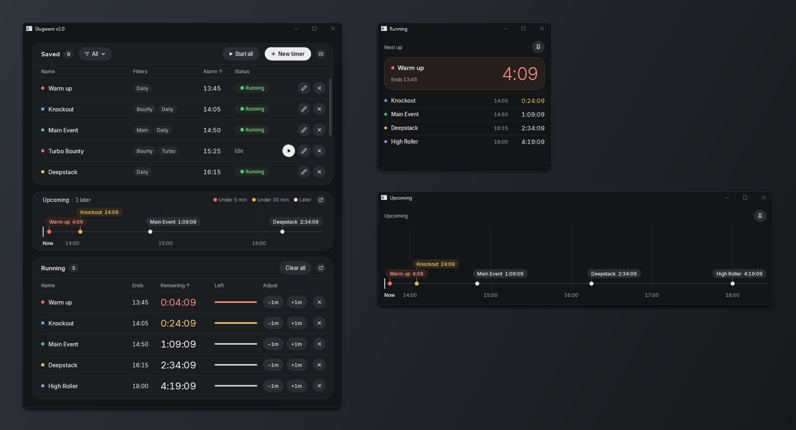
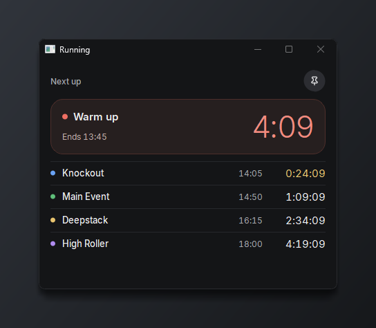
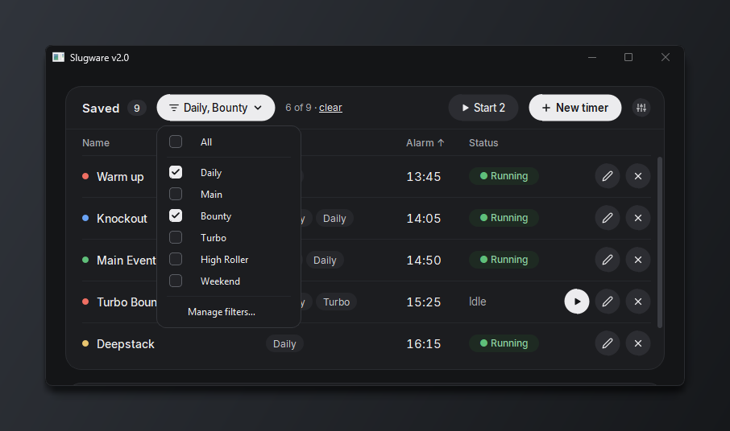

# Slugware

A desktop timer app for Windows, built for keeping track of poker tournament registration times. Save each tournament as an alarm at its start time, start the ones you're playing today, and see at a glance what's coming up next.



## Download

Get **Slugware-Setup-2.0.exe** from the [latest release](https://github.com/Gags30/Slugware_v2/releases/latest) and run it. It needs 64-bit Windows 10 or 11.

The installer isn't code-signed, so Windows SmartScreen may warn that "Windows protected your PC". Click **More info**, then **Run anyway**.

## Features

- **Saved timers**: alarms at a clock time (say, Main Event at 19:30) that you start when you want, one at a time or all at once with **Start all**.
- **Countdowns**: one-off timers for a set number of hours and minutes. Tick **Save For Future Use** to keep one as an alarm at the time it ends.
- **Running**: every active timer with its end time, time remaining, a progress bar and **−1m** / **+1m** buttons to nudge it. Timers turn yellow, then red, as they get close (both thresholds are adjustable).
- **Upcoming**: a timeline of the next 1 to 8 hours, so you can see how your tournaments are spaced out.
- **Pop-outs**: open Running or Upcoming in its own window, pin it on top of other apps, and it reopens where you left it.
- **Filters**: tag timers (Daily, Bounty, Turbo…) and show only the ones you want.
- **Site icons**: give each timer a coloured dot for the poker site it's on.
- **Alerts**: a popup, a sound, or both when a timer finishes.

| | |
|---|---|
|  |  |

Your timers and settings live in `%APPDATA%\Slugware`. Uninstalling leaves them in place, so a reinstall picks up where you left off. Delete that folder to start fresh.

## Run or build from source

You'll need Python 3 (it's developed on 3.13) and PyQt5:

```
pip install -r requirements.txt
python Slugware.py
```

To build the installer, install [PyInstaller](https://pyinstaller.org) and [Inno Setup 6](https://jrsoftware.org/isinfo.php), then run:

```
python -m PyInstaller --noconfirm --clean --onefile --windowed --name Slugware --icon Slug.ico Slugware.py
"C:\Program Files (x86)\Inno Setup 6\ISCC.exe" Slugware.iss
```

The installer is written to `installer/`.

## License

Copyright © 2026 Gags30

Slugware is free software: you can use, change and share it under the [GNU General Public License v3.0](LICENSE).

It's built with [PyQt5](https://www.riverbankcomputing.com/software/pyqt/) (GPL v3) and Qt (LGPL v3), and bundles the [Inter](https://github.com/rsms/inter) typeface under the SIL Open Font License ([fonts/OFL.txt](fonts/OFL.txt)).
